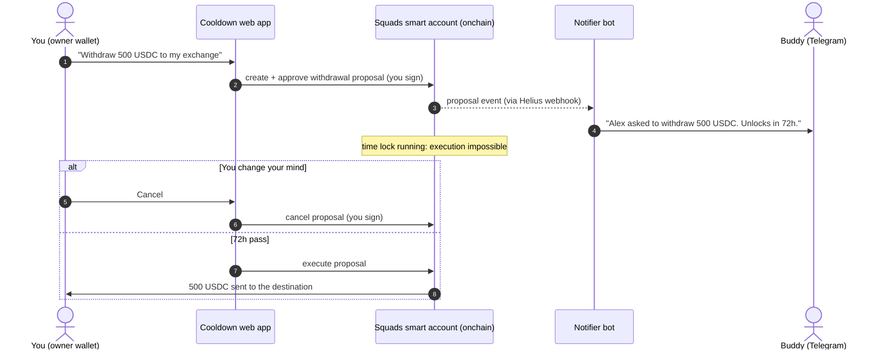
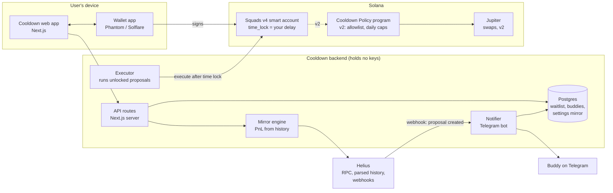

# Cooldown

**Rules you set when you're calm. Enforced onchain when you're not.**

Cooldown is a Solana account that protects your savings and salary from memecoins, perps and impulse sends.
You choose your rules on a good day (for example "any withdrawal waits 72 hours"), and the blockchain
enforces them on a bad day. Nobody can switch the rules off in the heat of the moment, not even you.

> **Status:** pre-alpha, in design. Nothing is deployed yet. Do not send real funds.
> Idea, research and validation plan live in `../Ideas/ideas/cooldown-solana/`.

---

## Table of contents

1. [Why this exists](#1-why-this-exists)
2. [What Cooldown does (plain English)](#2-what-cooldown-does-plain-english)
3. [Who it's for](#3-who-its-for)
4. [How it works, step by step](#4-how-it-works-step-by-step)
5. [Words you'll see (glossary for beginners)](#5-words-youll-see-glossary-for-beginners)
6. [Architecture](#6-architecture)
7. [The security model: why you can't cheat your own rules](#7-the-security-model-why-you-cant-cheat-your-own-rules)
8. [Tech stack](#8-tech-stack)
9. [Repository layout (planned)](#9-repository-layout-planned)
10. [Getting started (developers)](#10-getting-started-developers)
11. [Roadmap](#11-roadmap)
12. [How we know it's working (metrics and kill criteria)](#12-how-we-know-its-working-metrics-and-kill-criteria)
13. [Business model](#13-business-model)
14. [What Cooldown is not](#14-what-cooldown-is-not)
15. [Risks and open questions](#15-risks-and-open-questions)
16. [Safety, privacy and disclaimers](#16-safety-privacy-and-disclaimers)
17. [Sources](#17-sources)

---

## 1. Why this exists

- **Memecoin trading has worse odds than a slot machine.** One 2026 analysis of 44M pump.fun bets by 6.7M wallets found about
  **25¢ lost per $1** (a slot machine keeps about 3.5¢), and **49% of wallets lost 90% or more** of what they put in. This is one
  analyst's work and not peer-reviewed.
- **People who want to stop have no tool that works on crypto:**
  - Bank gambling blocks look for the gambling merchant code (7995). Crypto purchases use a different code (6051), so they get through.
  - Gamban blocks exchange websites, but it can't touch coins already in your own wallet, and it blocks *all* crypto.
  - SelfExclude.io only covers US prediction markets (Kalshi, Novig).
- **People are asking for it in their own words:**
  - "Need app to block cryptocasinos, will pay 500€ usdt" (r/problemgambling, Mar 2026)
  - "tools that can actually stop you from breaking your trading rules… hard-enforce, not warnings" (r/Daytrading, Sep 2026)
  - "throw my money at pump.fun, hate myself, get paid, repeat" (r/solana, Jul 2025)

Crypto created the problem by making it possible to move money instantly with no friction. Crypto can also fix it, because
a smart account can make "wait 72 hours" a rule nobody can break.

---

## 2. What Cooldown does (plain English)

| Feature | What it means for you |
|---|---|
| **Mirror** (free) | Paste any Solana wallet address. See the total money that went *into* memecoins and perps and the total that came *out*. Then "lock what's left". |
| **Cooling-off withdrawals** | Every time you take money out, it waits the delay you chose (24 hours to 30 days). You can cancel any time during the wait. |
| **Salary address** | Your account has its own address. Tell your employer, client or exchange to pay into it, so income lands somewhere you can't spend on impulse. |
| **Rules you can't loosen quickly** | Making rules *stricter* happens instantly. Making them *looser* waits the same cooling-off delay. |
| **Buddy alerts** | A partner, friend or sponsor gets a Telegram message whenever you ask to withdraw. They can't touch your money; they just know. |
| **Allowlist** (v2) | SOL, BTC and USDC can be bought instantly. New memecoins and perps are blocked or delayed. |
| **Daily caps** (v2) | A maximum spend or loss per day, and a maximum number of trades. |
| **Quit mode** (v2) | Full exclusion from memecoins and perps for 1–12 months. Can't be shortened. |

**You always own your money.** Cooldown never holds your keys or your funds. The account is a Solana smart account controlled
by your own wallet. We only make the delay impossible to skip.

---

## 3. Who it's for

| Person | What they want | Price |
|---|---|---|
| **The quitter.** Has said "I need to stop", and has savings or a salary left to protect. Often has a partner trying to help. | Protect what's left; make relapse slow instead of instant. | **Free, always.** |
| **The burned trader.** Still trades and has lost big at least once. | Hard limits they can't break mid-tilt; a vault for "money I'm not allowed to ape". | **Pro: $9–19/month** (to be tested). |
| **The buddy.** Partner, parent, friend or sponsor. | To know when withdrawals are requested, without controlling the person's money. | Free. |

---

## 4. How it works, step by step

### 4.1 First visit (no wallet needed)
1. Open the Mirror and paste a wallet address.
2. Cooldown reads that wallet's public transaction history and totals how much SOL/USDC went into memecoins and perps and how much came back.
3. You see something like *"In: $14,200 · Out: $3,100 · Net: −$11,100"*, with a button: **Lock what's left**.

### 4.2 Setting up a Cooldown account
1. Connect your normal wallet (Phantom, Solflare, Backpack…).
2. Choose your cooling-off delay, for example 72 hours.
3. Optional: add a buddy's Telegram handle.
4. Sign one transaction. This creates your Cooldown account onchain. You pay a small Solana fee (cents).
5. You get your **Cooldown address**. Send savings to it, and use it as your salary address.

### 4.3 Taking money out
1. Ask to withdraw X to address Y.
2. The request is recorded onchain with a timestamp. Your buddy gets a Telegram alert.
3. **The money cannot move until the delay has passed.** This is enforced by the Solana program, not by our website.
4. During the wait you can **cancel** with one click.
5. After the wait, you (or our helper bot) execute the withdrawal and the money moves.

### 4.4 Changing your rules
- Stricter (a longer delay, adding a buddy): instant.
- Looser (a shorter delay): goes through the same cooling-off as a withdrawal.



---

## 5. Words you'll see (glossary for beginners)

| Word | Simple meaning |
|---|---|
| **Wallet** | An app (like Phantom) that holds your keys and signs transactions. |
| **Smart account** | A wallet whose rules are written in code on the blockchain, e.g. "wait 72h before any withdrawal". |
| **Squads** | A widely used Solana smart-account program. We build on it instead of writing our own from scratch. |
| **Time lock** | A Squads setting: after a transaction is approved, it can't run until N seconds have passed. |
| **Proposal** | A request to do something (a withdrawal, a rule change) that waits for approval and the time lock. |
| **Vault address** | The address of your Cooldown account. Anything sent there is protected by your rules. |
| **PDA** | "Program Derived Address": an address owned by a program rather than a person. Your vault is one. |
| **Devnet** | Solana's test network. Fake money, used for development. |
| **Mainnet** | The real Solana network. Real money. |
| **Helius** | A Solana data provider. We use it to read transaction history and get notified of events. |
| **Non-custodial** | We never hold your money or keys. Only you can sign. |

---

## 6. Architecture

### 6.1 Big picture



### 6.2 Components

| Component | What it does | Phase |
|---|---|---|
| **Web app** (Next.js, React) | Mirror page, onboarding, account dashboard, withdraw/cancel buttons, rule settings. Connects to the user's wallet with Solana wallet adapters. | v0–v1 |
| **Mirror engine** | Pulls a wallet's parsed transaction history from Helius, classifies swaps (memecoin vs. allowlisted assets, perps deposits), and sums value in and out at the time of each trade. Read-only. | v0 |
| **Cooldown account** = Squads v4 smart account | One member (the user), threshold 1, `time_lock` = the chosen delay, **no config authority**, so every change, including loosening the delay, is a time-locked proposal. Funds sit in the vault PDA. | v1 |
| **Notifier** | A Helius webhook watches the user's smart account; on a new proposal it sends a Telegram message to the buddy (and the user). | v1 |
| **Executor** | Optional helper that executes proposals once their time lock has passed, so users don't have to come back. It can only execute what the user already approved; it can't create, approve or redirect anything. | v1 |
| **Database** (Postgres, e.g. Supabase) | Waitlist, pledges, buddy links (Telegram chat IDs), cached Mirror results, analytics. **Never** private keys or seed phrases. | v0–v1 |
| **Cooldown Policy program** (Anchor/Rust) | v2 rules Squads can't express: mint allowlist, daily spend/loss caps, max trades per day, quit mode. Audited before mainnet. | v2 |
| **Open blocklist** | A public list of memecoin terminals, trading bots and casino domains, offered to Gamban/BetBlocker. We don't build our own device blocker. | v1 |

### 6.3 Data the system keeps

| Data | Where | Why |
|---|---|---|
| Rules (delay, members) | **Onchain** (Squads account) | Source of truth; can't be edited by us |
| Pending withdrawals | **Onchain** (Squads proposals) | Source of truth for the time lock |
| Email / Telegram for waitlist and buddy | Postgres | Sending alerts |
| Mirror results | Postgres (cache) | Speed and share cards |
| Analytics (counts, retention) | Postgres | Kill criteria tracking |
| Keys, seed phrases, ID documents | **Nowhere** | We never collect them |

---

## 7. The security model: why you can't cheat your own rules

The whole product depends on one promise: **a person in a bad moment cannot shorten their own delay.**

How v1 keeps that promise with Squads v4:
1. The smart account is created **without a config authority**. Nobody, including you or us, can change settings outside the normal proposal flow.
2. Changing the time lock is itself a **config proposal**, and proposals must wait `time_lock` seconds after approval before they execute.
   So cutting 72h to 0h takes 72h.
3. Changing settings invalidates older pending proposals (Squads "stale transaction" rule), so you can't pre-queue tricks.
4. Cancelling a pending withdrawal is always allowed. Stopping yourself is never delayed.

**Must verify in week 1 (devnet):** that a single-member account with no config authority really can't shorten its own time lock
instantly. If it can, v1 needs a small custom program before any users. See the [roadmap](#11-roadmap).

What Cooldown **cannot** stop (stated honestly):
- You can always create a brand-new wallet and send *new* money there. Cooldown protects the money **inside** the account,
  which is why the salary address matters.
- Funds you already moved out before setting it up.

Threat checklist (to complete before mainnet):

| Threat | Mitigation |
|---|---|
| Our website gets hacked | The site can only ask you to sign; it can't move funds. Show clear transaction previews. |
| The executor key is stolen | It can only execute proposals you already approved, to the destinations you chose. |
| Squads program bug | Squads v4 is widely used and audited; we add no custom code to the money path in v1. |
| Phishing (fake Cooldown site) | Verified domain, warning copy, and we never ask for seed phrases. |
| v2 policy program bug | External audit before mainnet; deposit caps during beta. |

---

## 8. Tech stack

| Layer | Choice | Why |
|---|---|---|
| Frontend | Next.js (App Router), React, TypeScript, Tailwind | Fast to build with AI tools; one codebase for web and API |
| Wallets | `@solana/react-hooks` / `@solana/client` (or wallet-adapter) | Official Solana frontend tooling |
| Solana client | `@solana/kit` + Squads v4 SDK (`@sqds/multisig`) | Create the account, proposals, approve, cancel, execute |
| Data | Helius RPC, Enhanced Transactions API, webhooks | Parsed history for the Mirror; events for alerts |
| Prices | Jupiter / Birdeye price data | Value trades at the time they happened |
| Database | Postgres (Supabase) | Simple, free tier, auth if needed |
| Notifications | Telegram Bot API | Where crypto users already are |
| v2 program | Anchor (Rust), tested with LiteSVM / Surfpool | Standard Solana program tooling |
| Hosting | Vercel (web), a small worker for the executor | Cheap, simple |

---

## 9. Repository layout (planned)

```
cooldown/
├── README.md                 ← you are here
├── apps/
│   └── web/                  Next.js app: Mirror, onboarding, dashboard, API routes
├── packages/
│   ├── squads/               helpers: create account, propose, approve, cancel, execute
│   ├── mirror/               history parsing + PnL classification
│   └── shared/               types, constants, allowlists
├── services/
│   ├── notifier/             Helius webhook → Telegram bot
│   └── executor/             executes unlocked proposals
├── programs/
│   └── cooldown-policy/      v2 Anchor program (allowlist, caps, quit mode)
├── scripts/
│   └── devnet-timelock-test.ts   week-1 bypass test
└── docs/
    ├── security.md
    └── decisions/            short architecture decision records
```

---

## 10. Getting started (developers)

> These steps describe the intended setup; the code doesn't exist yet.

**Prerequisites**
- Node.js 20+ and `pnpm`
- Solana CLI (for devnet keypairs and airdrops)
- A Helius API key (free tier)
- A Telegram bot token (from @BotFather), only for the notifier
- Rust + Anchor, only for the v2 program

**Environment variables** (`apps/web/.env.local`; never commit this file)
```
NEXT_PUBLIC_SOLANA_CLUSTER=devnet
HELIUS_API_KEY=your_key_here
DATABASE_URL=postgres://...
TELEGRAM_BOT_TOKEN=only_for_notifier
```

**Run locally**
```bash
pnpm install
pnpm --filter web dev            # web app on http://localhost:3000
pnpm tsx scripts/devnet-timelock-test.ts   # week-1 security test
```

---

## 11. Roadmap

| Phase | When | What ships | Done when |
|---|---|---|---|
| **0. Prove it's safe** | Week 1 | Devnet script: create a single-member Squads account with a 1h time lock and no config authority; try to cut the time lock and withdraw instantly | The bypass fails (or we re-plan) |
| **1. Mirror** | Weeks 1–2 | Public Mirror page, share card, "lock what's left" pledge form | 2,000 lookups, 30 pledges (by 2026-12-31) |
| **2. Cooldown account v1** | Weeks 3–6 (Colosseum Eternal sprint) | Create account, salary address, withdraw → wait → cancel/execute, buddy alerts, open blocklist | 100 funded accounts (by 2027-02-28) |
| **3. Trader mode + v2 program** | Months 3–4 | Allowlist, daily caps, max trades, quit mode; audit; Pro subscription | 50 paying traders (by 2027-04-30) |
| **4. Partners** | Months 5–6 | White-label for a regulated exchange (first conversation: RocketX); recovery-charity referrals | 1 partner pilot |
| Later | Month 6+ | Cross-app exclusion registry with partners who must honour it | Only if regulation or partners demand it |

Funding path: Superteam India instagrant (month 1, with Mirror data) → Colosseum Eternal (4-week sprint) → Solana Foundation
or Solana Mobile builder grant (months 2–3, with retention data).

---

## 12. How we know it's working (metrics and kill criteria)

| Metric | Target | Kill if |
|---|---|---|
| Mirror lookups | 2,000 by 2026-12-31 | Fewer than 2,000 |
| Lock pledges (a specific amount) | 30 by 2026-12-31 | Fewer than 30 |
| Funded accounts | 100 by 2027-02-28 | Fewer than 100 |
| 30-day retention (still funded) | ≥ 60% | Below 60% |
| Paying traders or partner pilot | 50 payers or 1 pilot by 2027-04-30 | Neither → shrink to a free public good or stop |

---

## 13. Business model

1. **Free for quitters.** Always. Recovery users rarely pay, and they shouldn't have to.
2. **Trader Pro** ($9–19/month, to be tested): daily caps, trade limits, analytics.
3. **Yield share** (opt-in, after legal review): idle USDC can earn lending yield, and Cooldown keeps a small share.
   *We earn when you keep your money, not when you lose it.*
4. **White-label** for regulated exchanges and wallets that need responsible-trading tools.
5. **Grants** fund quit mode as a public good.

---

## 14. What Cooldown is not

- **Not treatment.** It's a tool that adds friction. If you're struggling, contact a gambling helpline (see below).
- **Not anti-trading.** We're against blowing up, not against trading.
- **Not custodial.** We can't freeze, take or move your money.
- **Not a guarantee.** It protects money inside the account; it can't stop you opening a new wallet.

---

## 15. Risks and open questions

| Risk | Plan |
|---|---|
| Squads time lock can be bypassed by a single owner | Week-1 devnet test; fall back to a minimal audited program |
| People won't lock their own money | Mirror pledges and X polls before building v1; kill criteria above |
| Trading venues won't cooperate | v1 needs no venue; venues come later as legal/PR cover |
| Yield = regulated investment product in some countries | Opt-in, lawyer review, off by default |
| Health and legal claims | No treatment claims; helplines linked; recovery-sector advisor |
| Solana Foundation optics ("casino" lawsuit) | Position as user-controlled safety rails, not rehab-first |

---

## 16. Safety, privacy and disclaimers

- We never ask for seed phrases or private keys. Anyone who does is not us.
- We store the minimum: email/Telegram for alerts and the waitlist. No ID documents in v1.
- Cooldown is experimental software. Use devnet until mainnet is announced; mainnet will start with deposit caps.
- **If gambling or trading is hurting you:** UK, GamCare / National Gambling Helpline 0808 8020 133; US, 1-800-GAMBLER;
  India, iCall (TISS) 9152987821 (general mental-health support). Check the numbers for your country.

---

## 17. Sources

- Pump.fun odds analysis (2026): https://youmind.com/landing/x-viral-articles/memecoin-casino-odds-analysis
- Self-exclusion gaps for crypto (Gambling Radar, 2026-10-20): https://gambling-radar.com/self-exclusion-when-gambling-with-crypto/
- Gamban blocks trading platforms: https://gamban.com/blog/gamban-blocks-trading-platforms
- SelfExclude.io: https://selfexclude.io/
- Commitment savings evidence (SEED study): https://www.povertyactionlab.org/print/pdf/node/1423
- Squads v4 account reference (`time_lock`): https://docs.squads.so/main/development/reference/accounts
- Solana docs for agents: https://solana.com/llms.txt
- Full research: `../Ideas/ideas/cooldown-solana/research/`

---

*License: to be decided. Built in India for everyone who's said "I need to stop."*
